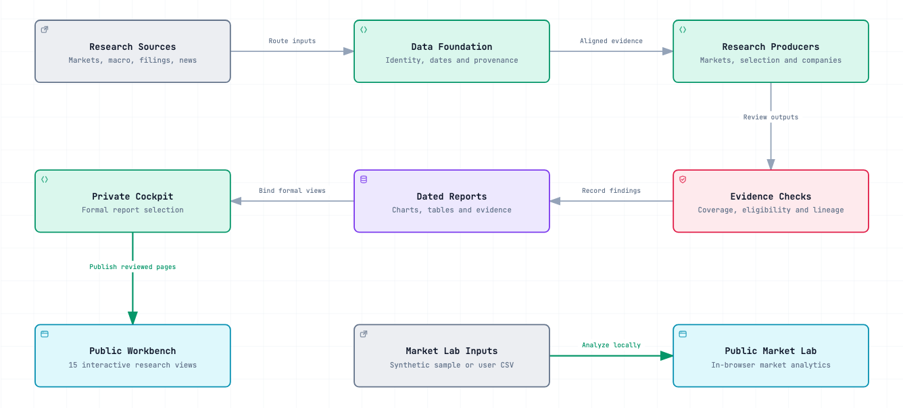

# Source-to-Trade Market Lab

[**Launch Market Lab**](https://z528li.github.io/ai-research-workbench/) · [Research workbench](https://ai-research-workbench-z528li-20261106.quaintpartridge1.chatgpt.site/)

Compare stocks with a benchmark, explore how returns behave when the market rises or falls, and measure how broadly gains are shared across your universe. The browser starts with an illustrative dataset so the controls work immediately.

## Explore the research system

The English Research Workbench presents 15 reviewed research views. This repository documents the system behind those views and includes the standalone Market Lab application.

- [Module capability index](docs/module-capabilities.md) covers all 88 registered modules, organized by function.
- [Workbench data pipelines](docs/pipelines/README.md) explains where each page gets its data, how the system processes and verifies it, and how it reaches the public Workbench.
- [Interactive architecture](https://z528li.github.io/ai-research-workbench/docs/architecture.html) traces the path from research inputs to publication and shows how Market Lab runs independently.

[](https://z528li.github.io/ai-research-workbench/docs/architecture.html)

The production source code and raw datasets remain private.

## Build your own daily workbench

The [self-hosted edition](self-hosted/README.md) builds a standalone English dashboard from public sources. Run the offline sample with `npm run workbench:demo`, or [configure daily updates on your GitHub fork](self-hosted/README.md#publish-a-daily-report-from-your-own-github-fork). It uses independent data and calculations, with optional SEC filings and local market analytics.

## Use your data

1. Select **Use your CSV** and choose a price file. **Download sample CSV** provides a ready-to-edit template.
2. Choose a stock, a benchmark from the file, an optional peer, and a lookback.
3. Move the chart's date slider to compare rebased prices. Click a ticker in the comparison table to switch the stock.

Use one row per ticker and date with `date,symbol,close` columns. Dates use `YYYY-MM-DD`. Supply consistent price series, preferably split- and dividend-adjusted, for every ticker. Use up to 300 tickers, 150,000 rows, and 5 MB. Prices must be between 0.000000000001 and 1 trillion.

```csv
date,symbol,close
2025-01-02,INDEX,100
2025-01-02,STOCK,50
2025-01-03,INDEX,101
2025-01-03,STOCK,52
```

The file stays in browser memory. The public package uses no API keys, brokerage connection, or bundled market data. The example uses generated prices for fictional tickers. The hosted research workbench offers dated research snapshots, while Market Lab recomputes these public features on the prices you supply.

## Calculations

- Performance uses shared dates and rebases each chart series to 100. The stock table compares percentage-point excess returns over each stock’s matched range.
- Beta estimates the slope of matched daily returns and shows a Bartlett-weighted Newey–West interval. It requires 20 usable pairs. Up- and down-market capture each require five observations in that direction.
- Breadth reports advancing stocks and the number above their 20-session average, with the eligible denominator for each measure.

See [market-analysis.js](market-analysis.js) for the complete calculation code.

## Run locally

[Download the ZIP](https://github.com/Z528LI/ai-research-workbench/archive/refs/heads/main.zip), extract it, and open `index.html` in a current browser. The HTML, CSS, and JavaScript files work together offline.

With Node.js installed, run `node --test tests/analysis.test.cjs` to verify the calculations. The application has no dependencies or build step.
